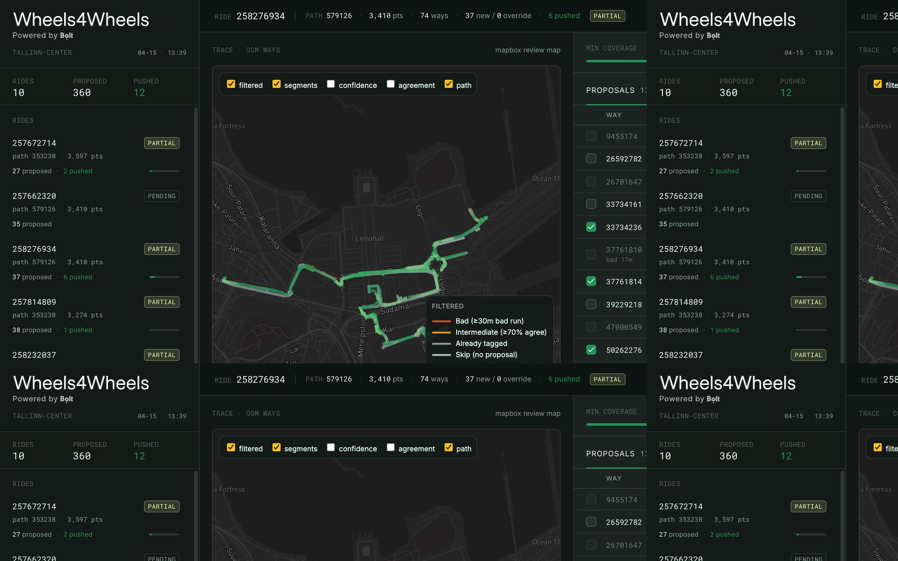

# W4W Tooling

Python pipeline and OpenStreetMap CLIs for Wheels4Wheels smoothness proposals.

This repo turns e-scooter telemetry into OSM `smoothness=*` review artifacts:

- per-way proposal CSVs
- Mapbox review maps
- GeoJSON for dashboard/demo use
- optional OSM upload manifests and edit commands

The review dashboard lives in `dashboard/`. It can run locally against generated
`output/` data, or as a Vercel demo against committed `dashboard/demo-output/output`
artifacts with OSM mutations disabled.

**Note:** Data in this repo and in the live demo is a small, curated excerpt – a handful of sample rides from central Tallinn, used for demonstration and reproducibility only. It does not represent the full telemetry dataset or complete coverage of any area and may be outdated.

[Live demo](https://w4w-tooling.vercel.app)



## Setup

```bash
uv sync
cp .env.example .env
```

Add `MAPBOX_ACCESS_TOKEN` to `.env`. OSM OAuth variables are only needed for `osm_edit.py`.

## Run Sample

```bash
uv run python scripts/OSM/OSM_smoothness_workflow.py \
  --input example_data/258276934-579126.json \
  --out-csv output/smoothness_proposals.csv \
  --out-map output/smoothness_proposals.html
```

## Batch Pipeline

Full telemetry files are local-only and gitignored under `telemetry_json/`.

```bash
uv run python scripts/OSM/select_rides.py --top-n 10
uv run python scripts/OSM/run_pipeline_batch.py
```

Batch output lands in `output/`, including `batch_manifest.json`, per-ride proposal CSVs, maps, and GeoJSON.

## OSM Edit CLI

```bash
uv run python scripts/OSM/osm_edit.py login
uv run python scripts/OSM/osm_edit.py set-tag \
  --way-id 123456 \
  --key smoothness \
  --value intermediate \
  --comment "W4W: smoothness from scooter telemetry"
```

Tokens are stored in `.osm_token.json`, which is gitignored.

## Dashboard Demo

```bash
cd dashboard
pnpm install
pnpm dev:demo
```

For Vercel, deploy `dashboard/` as the project root and set:

```bash
MAPBOX_ACCESS_TOKEN=...
NEXT_PUBLIC_W4W_DEMO_MODE=1
W4W_DASHBOARD_MODE=demo
```

Optional:

```bash
NEXT_PUBLIC_W4W_TOOLING_REPO_URL=https://github.com/<org>/w4w-tooling
```

## Data Policy

- Do not commit raw telemetry.
- Do not commit generated `output/`.
- Do not commit `.env`, `.osm_token.json`, or OAuth credentials.
- Keep `example_data/` small and safe for reproducible verification.
- `example_data/` and `dashboard/demo-output/` contain a demo excerpt only, not the full dataset.
